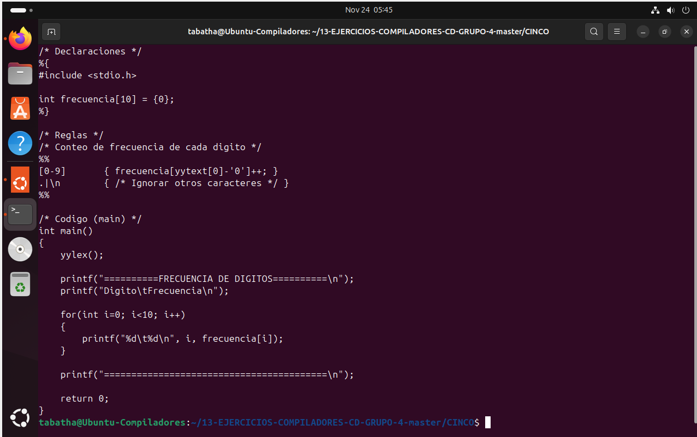
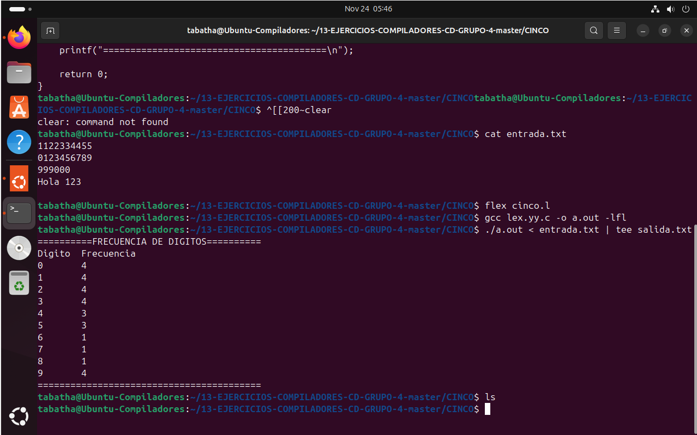

# Ejercicio 5. Frecuencia de dígitos

## Descripción del ejercicio

Cuenta las apariciones individuales de los caracteres del 0 al 9, sin considerar letras ni separadores. El resultado es una tabla de frecuencias absolutas, no una conversión de números completos.

## Código fuente (`cinco.l`)

```lex
/* Declaraciones */
%{
#include <stdio.h>

int frecuencia[10] = {0};
%}

/* Reglas */
/* Conteo de frecuencia de cada digito */
%%
[0-9]       { frecuencia[yytext[0]-'0']++; }
.|\n        { /* Ignorar otros caracteres */ }
%%

/* Codigo (main) */
int main()
{
    yylex();

    printf("==========FRECUENCIA DE DIGITOS==========\n");
    printf("Digito\tFrecuencia\n");

    for(int i=0; i<10; i++)
    {
        printf("%d\t%d\n", i, frecuencia[i]);
    }

    printf("=========================================\n");

    return 0;
}
```

## Explicación del código

Flex lee la especificación del archivo `.l` y genera `lex.yy.c`, que contiene el analizador en C. GCC compila ese archivo y enlaza la biblioteca de Flex mediante `-lfl`, que proporciona el comportamiento de fin de entrada necesario en estos programas. El primer delimitador `%%` abre la sección de reglas y el segundo la cierra. El bloque `%{ ... %}` contiene declaraciones de C copiadas al código generado. La función `main()` llama a `yylex()`, que consume la entrada estándar hasta el fin del archivo; `return 0` indica que el programa terminó normalmente.

Flex selecciona la regla que consume más caracteres. Si dos reglas consumen la misma cantidad, aplica la que aparece primero en la especificación. Esta propiedad permite distinguir patrones válidos de cadenas inválidas cuando ambas reglas podrían coincidir.

La biblioteca `stdio.h` permite imprimir los resultados. El arreglo `frecuencia[10]` reserva diez posiciones, cuyos índices van de 0 a 9. La inicialización `{0}` establece todos los contadores en cero antes de comenzar el análisis.

La regla `[0-9]` reconoce exactamente un dígito por coincidencia. `yytext[0]` contiene el carácter reconocido. Al restar `'0'` se obtiene su valor numérico: por ejemplo, `'5' - '0'` produce 5. Ese valor funciona como índice del arreglo; el operador `++` aumenta únicamente el contador correspondiente. La expresión `. | \n` (escrita sin espacios en el código) cubre los demás caracteres y el salto de línea, y su acción vacía los descarta. La regla de dígitos tiene prioridad sobre esa regla general cuando ambas coinciden con un carácter.

Después de `yylex()`, el ciclo `for` recorre los diez índices, incluso los que podrían tener frecuencia cero. El formato `%d` imprime enteros, `\t` separa columnas y `\n` inicia una nueva fila. Las líneas de signos iguales delimitan visualmente la tabla.

## Archivo de entrada (`entrada.txt`)

```text
1122334455
0123456789
999000
Hola 123
```

## Compilación y ejecución

Desde la carpeta `CINCO`, se ejecutan los comandos:

```bash
flex cinco.l && gcc lex.yy.c -o a.out -lfl && ./a.out < entrada.txt | tee salida.txt
```

El operador `&&` permite continuar solo si el comando anterior finaliza correctamente. La redirección `< entrada.txt` proporciona al analizador los datos de prueba sin introducirlos manualmente. `tee salida.txt` muestra el resultado en la terminal y lo guarda en el archivo de salida. `ls -l` permite comprobar la presencia del código fuente, los archivos de entrada y salida, el C generado y el ejecutable.

## Archivo de salida (`salida.txt`)

```text
==========FRECUENCIA DE DIGITOS==========
Digito	Frecuencia
0	4
1	4
2	4
3	4
4	3
5	3
6	1
7	1
8	1
9	4
=========================================
```

## Interpretación de los resultados

La primera línea contiene dos apariciones de cada dígito del 1 al 5; la segunda añade una aparición de todos los dígitos. La tercera aporta tres nueves y tres ceros. En la última, las letras de `Hola` y el espacio se descartan, mientras que 1, 2 y 3 incrementan sus contadores.

| Dígitos | Frecuencia individual | Explicación |
|---|---:|---|
| 0 | 4 | Uno en la segunda línea y tres en la tercera |
| 1, 2, 3 | 4 | Dos en la primera, uno en la segunda y uno en la última |
| 4, 5 | 3 | Dos en la primera y uno en la segunda |
| 6, 7, 8 | 1 | Solo aparecen en la segunda |
| 9 | 4 | Uno en la segunda y tres en la tercera |

La suma de las frecuencias es 29, igual al total de dígitos de las cuatro líneas (10 + 10 + 6 + 3). La ejecución confirma que el arreglo conserva los conteos acumulados durante todo el archivo.

## Evidencias de ejecución



*Figura 1. Código fuente del analizador.*



*Figura 2. Compilación, entrada y resultados de la ejecución en Ubuntu.*

Referencia técnica: [Manual de Flex](https://westes.github.io/flex/manual/).
