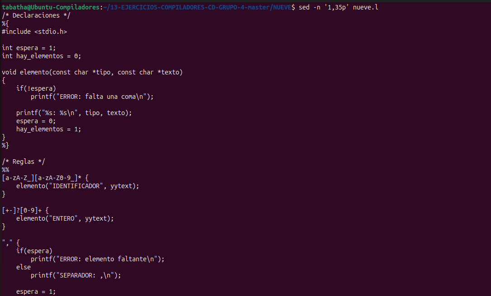
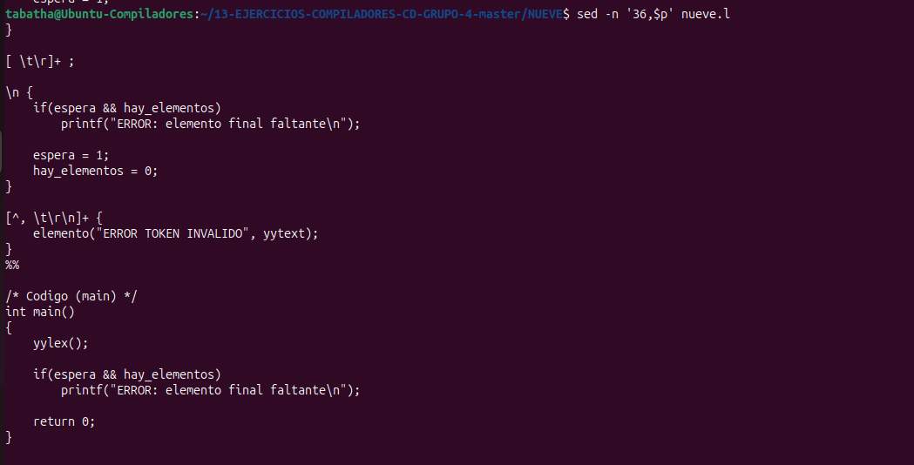
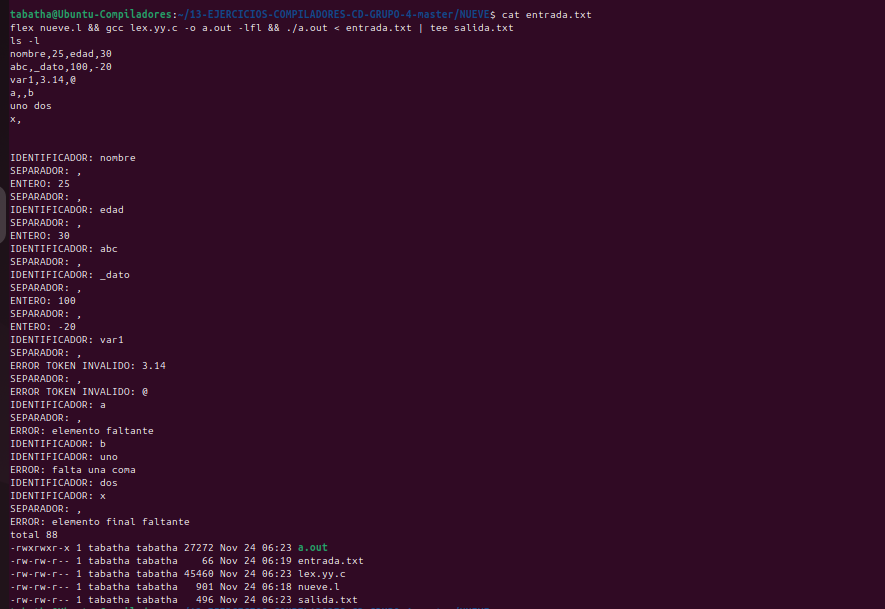

# Ejercicio 9. Listas separadas por comas

## Descripción del ejercicio

Procesa una lista por línea, reconoce identificadores y enteros con signo opcional y reporta tokens inválidos y errores básicos de separación. Conserva un estado sencillo para comprobar la alternancia entre elementos y comas.

## Código fuente (`nueve.l`)

```lex
/* Declaraciones */
%{
#include <stdio.h>

int espera = 1;
int hay_elementos = 0;

void elemento(const char *tipo, const char *texto)
{
    if(!espera)
        printf("ERROR: falta una coma\n");

    printf("%s: %s\n", tipo, texto);
    espera = 0;
    hay_elementos = 1;
}
%}

/* Reglas */
%%
[a-zA-Z_][a-zA-Z0-9_]* {
    elemento("IDENTIFICADOR", yytext);
}

[+-]?[0-9]+ {
    elemento("ENTERO", yytext);
}

"," {
    if(espera)
        printf("ERROR: elemento faltante\n");
    else
        printf("SEPARADOR: ,\n");

    espera = 1;
}

[ \t\r]+ ;

\n {
    if(espera && hay_elementos)
        printf("ERROR: elemento final faltante\n");

    espera = 1;
    hay_elementos = 0;
}

[^, \t\r\n]+ {
    elemento("ERROR TOKEN INVALIDO", yytext);
}
%%

/* Codigo (main) */
int main()
{
    yylex();

    if(espera && hay_elementos)
        printf("ERROR: elemento final faltante\n");

    return 0;
}
```

## Explicación del código

Flex lee la especificación del archivo `.l` y genera `lex.yy.c`, que contiene el analizador en C. GCC compila ese archivo y enlaza la biblioteca de Flex mediante `-lfl`, que proporciona el comportamiento de fin de entrada necesario en estos programas. El primer delimitador `%%` abre la sección de reglas y el segundo la cierra. El bloque `%{ ... %}` contiene declaraciones de C copiadas al código generado. La función `main()` llama a `yylex()`, que consume la entrada estándar hasta el fin del archivo; `return 0` indica que el programa terminó normalmente.

Flex selecciona la regla que consume más caracteres. Si dos reglas consumen la misma cantidad, aplica la que aparece primero en la especificación. Esta propiedad permite distinguir patrones válidos de cadenas inválidas cuando ambas reglas podrían coincidir.

Las variables globales `espera` y `hay_elementos` representan el estado de la lista. `espera = 1` significa que corresponde recibir un elemento; `espera = 0` indica que ya se recibió uno y corresponde una coma o el fin de la línea. `hay_elementos` indica si se procesó algún elemento en la lista actual.

La función `elemento()` recibe el tipo y el lexema. Si `!espera` es verdadero, detecta dos elementos consecutivos sin coma. Después imprime el token, cambia `espera` a cero y registra que existe un elemento. Los parámetros `const char *` permiten leer las cadenas sin modificarlas dentro de la función.

`[a-zA-Z_][a-zA-Z0-9_]*` reconoce identificadores que empiezan con letra o guion bajo y admiten dígitos después. `[+-]?[0-9]+` reconoce enteros con un signo opcional (`?`) y uno o más dígitos (`+`). La regla `","` reconoce una coma literal: si ya se esperaba un elemento, reporta uno faltante; de lo contrario imprime el separador. En ambos casos vuelve al estado de espera de elemento.

Los espacios, tabulaciones y retornos de carro se ignoran. El salto de línea comprueba si la lista termina con una coma después de haber procesado elementos y reinicia las variables para la línea siguiente. La regla `[^, \t\r\n]+` recoge tokens no reconocidos sin consumir comas. Al usar `elemento()` para reportarlos, el programa conserva la posición de ese elemento erróneo y continúa con el resto de la lista. Por ejemplo, `3.14` se consume como un token inválido completo en vez de fragmentarse en enteros.

En `main()`, la comprobación posterior a `yylex()` permite detectar una coma final incluso cuando el archivo no termina en un salto de línea. El programa reporta errores sin interrumpir el análisis; no es un parser general ni convierte los enteros a valores numéricos.

## Archivo de entrada (`entrada.txt`)

```text
nombre,25,edad,30
abc,_dato,100,-20
var1,3.14,@
a,,b
uno dos
x,
```

## Compilación y ejecución

Desde la carpeta `NUEVE`, se ejecutan los comandos:

```bash
flex nueve.l && gcc lex.yy.c -o a.out -lfl && ./a.out < entrada.txt | tee salida.txt
```

El operador `&&` permite continuar solo si el comando anterior finaliza correctamente. La redirección `< entrada.txt` proporciona al analizador los datos de prueba sin introducirlos manualmente. `tee salida.txt` muestra el resultado en la terminal y lo guarda en el archivo de salida. `ls -l` permite comprobar la presencia del código fuente, los archivos de entrada y salida, el C generado y el ejecutable.

## Archivo de salida (`salida.txt`)

```text
IDENTIFICADOR: nombre
SEPARADOR: ,
ENTERO: 25
SEPARADOR: ,
IDENTIFICADOR: edad
SEPARADOR: ,
ENTERO: 30
IDENTIFICADOR: abc
SEPARADOR: ,
IDENTIFICADOR: _dato
SEPARADOR: ,
ENTERO: 100
SEPARADOR: ,
ENTERO: -20
IDENTIFICADOR: var1
SEPARADOR: ,
ERROR TOKEN INVALIDO: 3.14
SEPARADOR: ,
ERROR TOKEN INVALIDO: @
IDENTIFICADOR: a
SEPARADOR: ,
ERROR: elemento faltante
IDENTIFICADOR: b
IDENTIFICADOR: uno
ERROR: falta una coma
IDENTIFICADOR: dos
IDENTIFICADOR: x
SEPARADOR: ,
ERROR: elemento final faltante
```

## Interpretación de los resultados

| Lista | Resultado observado |
|---|---|
| `nombre,25,edad,30` | Dos identificadores, dos enteros y tres separadores |
| `abc,_dato,100,-20` | Reconoce el guion bajo y el entero negativo |
| `var1,3.14,@` | Reporta `3.14` y `@` como tokens inválidos |
| `a,,b` | Detecta un elemento faltante entre comas |
| `uno dos` | Detecta una coma faltante entre identificadores |
| `x,` | Detecta un elemento final faltante |

En la primera lista, el analizador alterna entre el estado de espera de elemento y el estado de espera de separador. En las listas incorrectas, conserva el análisis de los elementos posteriores, por lo que es posible observar varios errores en una sola ejecución. La salida registra cinco mensajes de error: dos tokens inválidos y tres problemas de separación. Los casos ensayados muestran la clasificación léxica y el control básico de estructura sin que sea necesario detener el programa al encontrar un error.

## Evidencias de ejecución



*Figura 1. Código fuente del analizador, parte 1.*



*Figura 2. Código fuente del analizador, parte 2.*



*Figura 3. Compilación, entrada y resultados de la ejecución en Ubuntu.*

Referencia técnica: [Manual de Flex](https://westes.github.io/flex/manual/).
