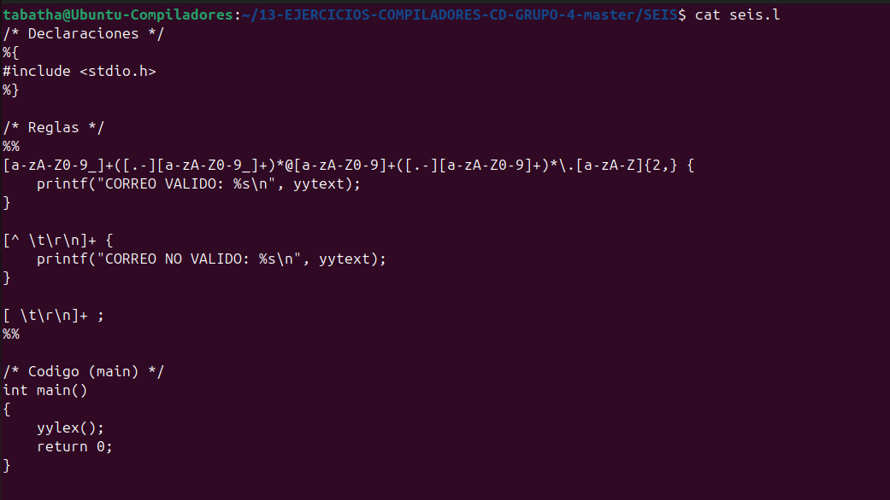
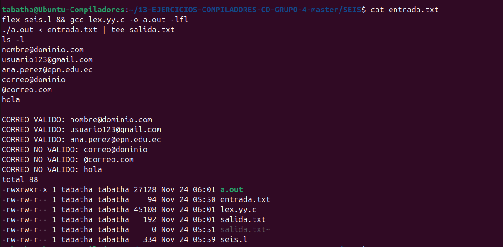

# Ejercicio 6. Reconocimiento de correos electrónicos

## Descripción del ejercicio

Clasifica cadenas separadas por espacios o saltos de línea como correos válidos o no válidos según un patrón léxico simplificado. No verifica la existencia de una cuenta ni implementa todas las reglas de los estándares de correo.

## Código fuente (`seis.l`)

```lex
/* Declaraciones */
%{
#include <stdio.h>
%}

/* Reglas */
%%
[a-zA-Z0-9_]+([.-][a-zA-Z0-9_]+)*@[a-zA-Z0-9]+([.-][a-zA-Z0-9]+)*\.[a-zA-Z]{2,} {
    printf("CORREO VALIDO: %s\n", yytext);
}

[^ \t\r\n]+ {
    printf("CORREO NO VALIDO: %s\n", yytext);
}

[ \t\r\n]+ ;
%%

/* Codigo (main) */
int main()
{
    yylex();
    return 0;
}
```

## Explicación del código

Flex lee la especificación del archivo `.l` y genera `lex.yy.c`, que contiene el analizador en C. GCC compila ese archivo y enlaza la biblioteca de Flex mediante `-lfl`, que proporciona el comportamiento de fin de entrada necesario en estos programas. El primer delimitador `%%` abre la sección de reglas y el segundo la cierra. El bloque `%{ ... %}` contiene declaraciones de C copiadas al código generado. La función `main()` llama a `yylex()`, que consume la entrada estándar hasta el fin del archivo; `return 0` indica que el programa terminó normalmente.

Flex selecciona la regla que consume más caracteres. Si dos reglas consumen la misma cantidad, aplica la que aparece primero en la especificación. Esta propiedad permite distinguir patrones válidos de cadenas inválidas cuando ambas reglas podrían coincidir.

`stdio.h` habilita `printf`. La primera regla contiene el patrón completo de correo. `[a-zA-Z0-9_]+` exige al menos una letra, dígito o guion bajo en el usuario. `([.-][a-zA-Z0-9_]+)*` permite cero o más grupos adicionales precedidos por un punto o guion. El asterisco es importante: sin él se exigiría una separación adicional en todos los nombres de usuario.

El carácter `@` separa el usuario del dominio. `[a-zA-Z0-9]+` exige una parte inicial alfanumérica del dominio; `([.-][a-zA-Z0-9]+)*` permite segmentos adicionales opcionales. `\.` representa un punto literal, mientras que `[a-zA-Z]{2,}` exige una extensión de al menos dos letras. Los dos asteriscos permiten tanto dominios simples como nombres con subdominios.

La segunda regla `[^ \t\r\n]+` consume una cadena completa que no contiene espacios, tabulaciones ni saltos de línea. Si una cadena completa cumple el patrón de correo, ambas reglas pueden coincidir con la misma longitud, pero la primera gana por su posición. Si solo un prefijo parece válido y el resto es incorrecto, la segunda regla puede consumir más caracteres y reportar el token entero como inválido. La última regla descarta los separadores. `yytext` conserva el lexema para imprimirlo con `%s`.

## Archivo de entrada (`entrada.txt`)

```text
nombre@dominio.com
usuario123@gmail.com
ana.perez@epn.edu.ec
correo@dominio
@correo.com
hola
```

## Compilación y ejecución

Desde la carpeta `SEIS`, se ejecutan los comandos:

```bash
flex seis.l && gcc lex.yy.c -o a.out -lfl && ./a.out < entrada.txt | tee salida.txt
```

El operador `&&` permite continuar solo si el comando anterior finaliza correctamente. La redirección `< entrada.txt` proporciona al analizador los datos de prueba sin introducirlos manualmente. `tee salida.txt` muestra el resultado en la terminal y lo guarda en el archivo de salida. `ls -l` permite comprobar la presencia del código fuente, los archivos de entrada y salida, el C generado y el ejecutable.

## Archivo de salida (`salida.txt`)

```text
CORREO VALIDO: nombre@dominio.com
CORREO VALIDO: usuario123@gmail.com
CORREO VALIDO: ana.perez@epn.edu.ec
CORREO NO VALIDO: correo@dominio
CORREO NO VALIDO: @correo.com
CORREO NO VALIDO: hola
```

## Interpretación de los resultados

| Cadena | Clasificación | Motivo |
|---|---|---|
| nombre@dominio.com | Válida | Usuario, dominio y extensión presentes |
| usuario123@gmail.com | Válida | El usuario admite dígitos |
| ana.perez@epn.edu.ec | Válida | Admite punto en el usuario y segmentos del dominio |
| correo@dominio | Inválida | Falta punto y extensión |
| @correo.com | Inválida | Falta el usuario |
| hola | Inválida | No presenta estructura de correo |

La salida definitiva muestra tres correos válidos y tres inválidos. Se utiliza la versión corregida de la expresión regular, que contiene ambos asteriscos. Así se evita rechazar direcciones simples como `nombre@dominio.com`. El mensaje impreso identifica tanto la clase del token como su lexema original.

## Evidencias de ejecución



*Figura 1. Código fuente del analizador.*



*Figura 2. Compilación, entrada y resultados de la ejecución en Ubuntu.*

Referencia técnica: [Manual de Flex](https://westes.github.io/flex/manual/).
