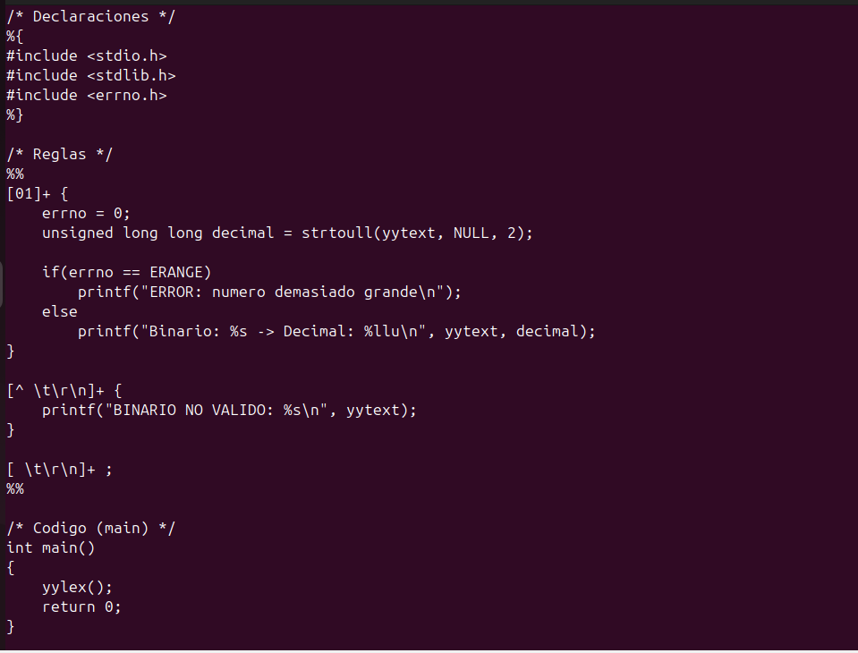
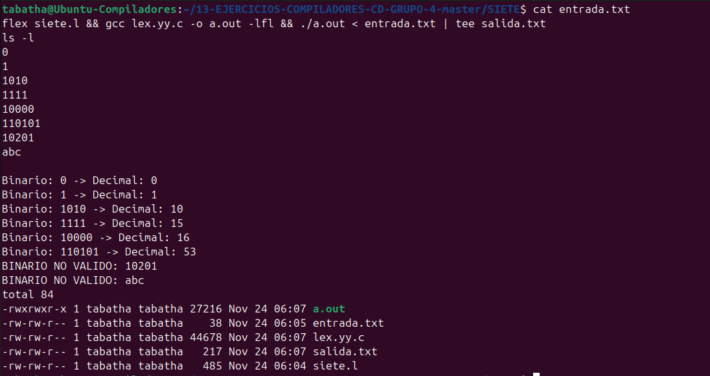

# Ejercicio 7. Conversión de binario a decimal

## Descripción del ejercicio

Reconoce tokens en base 2, convierte su valor a base diez y reporta cadenas que no cumplen la expresión regular. El análisis léxico distingue el formato antes de efectuar la conversión numérica.

## Código fuente (`siete.l`)

```lex
/* Declaraciones */
%{
#include <stdio.h>
#include <stdlib.h>
#include <errno.h>
%}

/* Reglas */
%%
[01]+ {
    errno = 0;
    unsigned long long decimal = strtoull(yytext, NULL, 2);

    if(errno == ERANGE)
        printf("ERROR: numero demasiado grande\n");
    else
        printf("Binario: %s -> Decimal: %llu\n", yytext, decimal);
}

[^ \t\r\n]+ {
    printf("BINARIO NO VALIDO: %s\n", yytext);
}

[ \t\r\n]+ ;
%%

/* Codigo (main) */
int main()
{
    yylex();
    return 0;
}
```

## Explicación del código

Flex lee la especificación del archivo `.l` y genera `lex.yy.c`, que contiene el analizador en C. GCC compila ese archivo y enlaza la biblioteca de Flex mediante `-lfl`, que proporciona el comportamiento de fin de entrada necesario en estos programas. El primer delimitador `%%` abre la sección de reglas y el segundo la cierra. El bloque `%{ ... %}` contiene declaraciones de C copiadas al código generado. La función `main()` llama a `yylex()`, que consume la entrada estándar hasta el fin del archivo; `return 0` indica que el programa terminó normalmente.

Flex selecciona la regla que consume más caracteres. Si dos reglas consumen la misma cantidad, aplica la que aparece primero en la especificación. Esta propiedad permite distinguir patrones válidos de cadenas inválidas cuando ambas reglas podrían coincidir.

La biblioteca `stdio.h` permite imprimir, `stdlib.h` declara `strtoull` y `errno.h` proporciona `errno` y `ERANGE` para detectar errores de rango.

`[01]+` admite una secuencia no vacía formada exclusivamente por ceros y unos. El operador `+` exige una o más repeticiones. El texto reconocido queda disponible en `yytext`. Antes de convertir, `errno = 0` elimina indicadores de errores anteriores. La función `strtoull(yytext, NULL, 2)` interpreta la cadena en base 2 y devuelve un entero sin signo de tipo `unsigned long long`. El argumento `NULL` indica que no se requiere guardar la posición donde finaliza la conversión; la expresión regular ya comprueba el formato del token.

Si `errno == ERANGE`, el valor excede el rango representable y se imprime un mensaje de error. En caso contrario, `%s` muestra el lexema original y `%llu` imprime el resultado decimal. La regla general `[^ \t\r\n]+` captura cadenas inválidas completas; por coincidencia más larga evita aceptar solamente un prefijo de una cadena incorrecta. Cuando las dos reglas coinciden con la cadena completa, prevalece la regla válida por estar primero. Los espacios y saltos de línea se ignoran mediante `[ \t\r\n]+`.

## Archivo de entrada (`entrada.txt`)

```text
0
1
1010
1111
10000
110101
10201
abc
```

## Compilación y ejecución

Desde la carpeta `SIETE`, se ejecutan los comandos:

```bash
flex siete.l && gcc lex.yy.c -o a.out -lfl && ./a.out < entrada.txt | tee salida.txt
```

El operador `&&` permite continuar solo si el comando anterior finaliza correctamente. La redirección `< entrada.txt` proporciona al analizador los datos de prueba sin introducirlos manualmente. `tee salida.txt` muestra el resultado en la terminal y lo guarda en el archivo de salida. `ls -l` permite comprobar la presencia del código fuente, los archivos de entrada y salida, el C generado y el ejecutable.

## Archivo de salida (`salida.txt`)

```text
Binario: 0 -> Decimal: 0
Binario: 1 -> Decimal: 1
Binario: 1010 -> Decimal: 10
Binario: 1111 -> Decimal: 15
Binario: 10000 -> Decimal: 16
Binario: 110101 -> Decimal: 53
BINARIO NO VALIDO: 10201
BINARIO NO VALIDO: abc
```

## Interpretación de los resultados

| Entrada | Resultado | Interpretación |
|---|---:|---|
| `0` | 0 | Conversión válida |
| `1` | 1 | Conversión válida |
| `1010` | 10 | Conversión válida |
| `1111` | 15 | Conversión válida |
| `10000` | 16 | Conversión válida |
| `110101` | 53 | Conversión válida |
| `10201` | — | Token inválido |
| `abc` | — | Token inválido |

El valor de `110101` se obtiene como 32 + 16 + 4 + 1 = 53. `1010` equivale a 8 + 2 = 10. La cadena `10201` contiene un 2 y `abc` contiene letras, por lo que ninguna pertenece al lenguaje binario.

La salida observada contiene seis conversiones correctas y dos rechazos. Las pruebas verifican el formato y la conversión de los valores pequeños proporcionados; no ejercitan la rama de desbordamiento.

## Evidencias de ejecución



*Figura 1. Código fuente del analizador.*



*Figura 2. Compilación, entrada y resultados de la ejecución en Ubuntu.*

Referencia técnica: [Manual de Flex](https://westes.github.io/flex/manual/).
